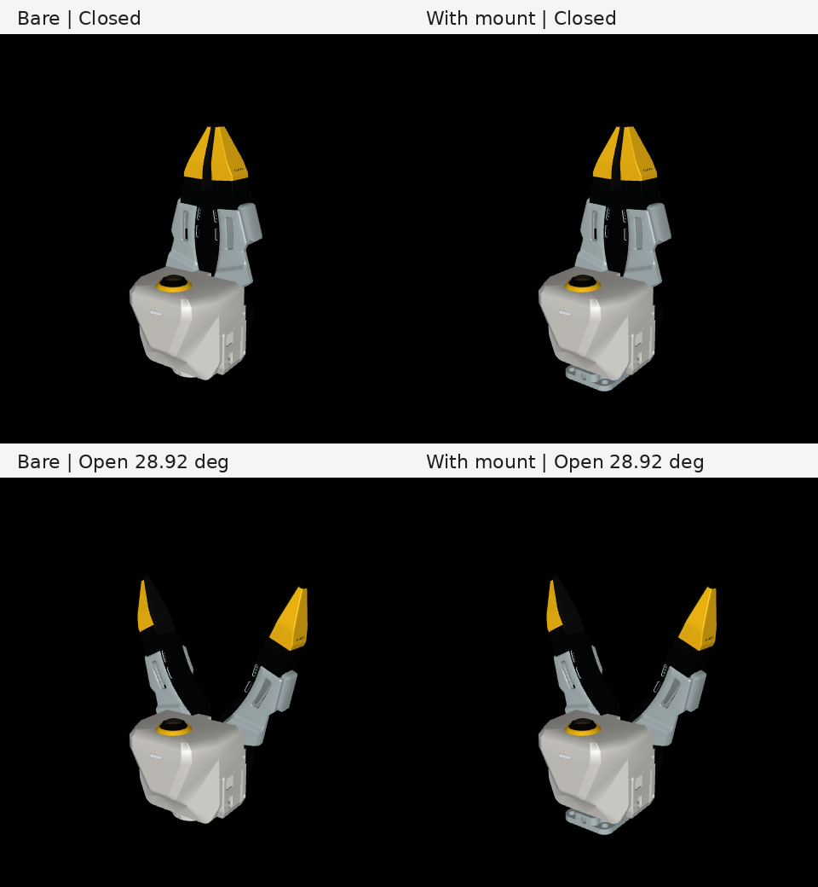

# XTac-UMI-Description

[English](README.md)

**XTac-UMI G1** 触觉数据采集夹爪的机器人描述文件，提供 URDF、Xacro、MJCF 和 USD：

- **主夹爪**（手持，leader）：左手与右手。
- **从夹爪**（装在机械臂上，follower）：裸爪，或带 Asm_link 法兰转接件。



## 目录结构

```
ros/taccap_slave_description/    ROS 2 包：从爪资产（URDF、Xacro、MJCF、USD、网格、launch）
ros/taccap_master_description/   ROS 2 包：主爪资产，左右手
python/taccap_description/       Python 包：基于上面两个 ROS 包的路径接口
scripts/                         生成脚本，所有派生文件都由它们生成
docs/                            坐标系规范与外观
```

资产只放在 `ros/` 下。Python 包本身不含数据：它的 wheel 把两个 ROS 包目录装成
`taccap_description.share`，所以 pip 安装和 ROS 安装读取的是同一份文件。

## 快速开始

ROS 2（Humble/Jazzy）：

```bash
cd ~/ws/src && git clone https://github.com/XenseRobotics-AI/XTac-UMI-Description.git
cd ~/ws && colcon build && source install/setup.bash
ros2 launch taccap_slave_description display.launch.py with_mount:=true
ros2 launch taccap_master_description display.launch.py side:=left
```

把从爪装到机械臂上：

```xml
<xacro:include filename="$(find taccap_slave_description)/urdf/taccap_g1_slave_macro.xacro"/>
<xacro:taccap_g1_slave prefix="right_" with_mount="false"/>
<joint name="arm_to_gripper" type="fixed">
  <parent link="tool0"/><child link="right_taccap_base_link"/>
  <origin xyz="0 0 0" rpy="0 0 0"/>  <!-- 绕 Z 的安装角按实际调整 -->
</joint>
```

Python（无需 ROS）：

```bash
pip install git+https://github.com/XenseRobotics-AI/XTac-UMI-Description.git
```

```python
from taccap_description import slave, master

slave.get_urdf_path(with_mount=True)
slave.get_usd_path()
master.get_urdf_path(side="left")
master.get_usd_path(side="right", animated=True)
```

两个模块都提供 `get_urdf_path`、`get_xacro_path`、`get_mjcf_path`、`get_usd_path`；
从爪的参数是 `with_mount=`，主爪是 `side=`。普通 `.urdf` 使用相对网格路径，可直接用
URDF 查看器打开。

## 关键参数

| 项目 | 数值 |
| --- | --- |
| 坐标轴（所有 link） | +Z 沿工具轴指向指尖，+Y 指向左手指 |
| 手指开合 | 0 至 0.5047 rad（28.92°）；右手指主动，左手指镜像跟随 |
| 从爪手指电机 | RobStride EL05，最大输出扭矩 1.1 N·m |
| 从爪 EEF（闭合指尖中心） | 距 `taccap_base_link` 为 `[0.036575, 0, 0.2009217]` m（带转接件时再加 12 mm） |
| 主从对应 | `<side>_follower_link` 等同于从爪 `taccap_base_link`；EEF、指尖、相机偏差小于 0.1 mm |
| 追踪器 | `<side>_tracker_link` 精确复现 TacCap-Gripper 内置的 tracker → EE 外参 |

规范文档：[坐标系、法兰与命名](docs/TACCAP_FLANGE_FRAMES-zh.md) · [外观](docs/APPEARANCE-zh.md)。

## 开发

```bash
pip install -e '.[dev]'
python scripts/generate_models.py           # 从 Xacro 生成从爪 URDF + MJCF
python scripts/generate_usd.py              # 从爪 USD
python scripts/generate_master_models.py    # 从主爪 URDF 生成 Xacro、MJCF、USD
python scripts/generate_appearance_parts.py # 按材质拆分的网格零件、丝印
python -m pytest -q
```

只需手工编辑从爪 Xacro（`ros/taccap_slave_description/urdf/taccap_g1_slave_macro.xacro`）和
主爪 URDF（`ros/taccap_master_description/urdf/taccap_g1_master_{left,right}.urdf`）；颜色来自
[外观](docs/APPEARANCE-zh.md)中说明的数据文件。其余文件都是生成的。所有生成器都支持 `--check`，
CI 用它拒绝过期文件。

## 相关链接

- [XTac-UMI G1 文档](https://xenserobotics-ai.github.io/XTac-UMI-G1-Docs/)
- [TacCap-Gripper SDK](https://github.com/XenseRobotics-AI/TacCap-Gripper)：电机控制、IMU/编码器读取、逐台相机内参

## 许可与联系

MIT 许可，见 [LICENSE](LICENSE)。来源与第三方声明：
[从爪](ros/taccap_slave_description/NOTICE.md)、[主爪](ros/taccap_master_description/NOTICE.md)。

问题请提交 GitHub issue 或联系 dylan@xenserobotics.com。
