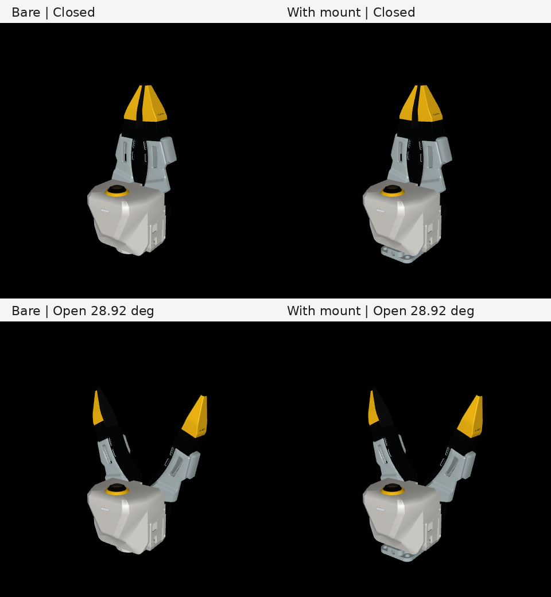

# XTac-UMI-Description

[中文](README-zh.md)

Robot descriptions of the **XTac-UMI G1** tactile data-collection gripper, in
URDF, Xacro, MJCF and USD:

- **Master** (handheld, the leader): left and right.
- **Slave** (arm-mounted, the follower): bare, or with the flange adapter.



## Layout

```
ros/taccap_slave_description/    ROS 2 package: slave assets (URDF, Xacro, MJCF, USD, meshes, launch)
ros/taccap_master_description/   ROS 2 package: master assets, left and right
python/taccap_description/       Python package: path helpers over the two ROS packages
scripts/                         Generators; all derived files are produced from these
docs/                            Frame specification and appearance
```

The assets live only under `ros/`. The Python package holds no data of its own:
its wheel installs the two ROS package directories as `taccap_description.share`,
so a pip install and a ROS install read the very same files.

## Quick start

ROS 2 (Humble/Jazzy):

```bash
cd ~/ws/src && git clone https://github.com/XenseRobotics-AI/XTac-UMI-Description.git
cd ~/ws && colcon build && source install/setup.bash
ros2 launch taccap_slave_description display.launch.py with_mount:=true
ros2 launch taccap_master_description display.launch.py side:=left
```

Attach the slave to your arm:

```xml
<xacro:include filename="$(find taccap_slave_description)/urdf/taccap_g1_slave_macro.xacro"/>
<xacro:taccap_g1_slave prefix="right_" with_mount="false"/>
<joint name="arm_to_gripper" type="fixed">
  <parent link="tool0"/><child link="right_taccap_base_link"/>
  <origin xyz="0 0 0" rpy="0 0 0"/>  <!-- clocking about Z per installation -->
</joint>
```

Python, no ROS needed:

```bash
pip install git+https://github.com/XenseRobotics-AI/XTac-UMI-Description.git
```

```python
from taccap_description import slave, master

slave.get_urdf_path(with_mount=True)
slave.get_usd_path()
master.get_urdf_path(side="left")
master.get_usd_path(side="right", animated=True)
```

Both modules offer `get_urdf_path`, `get_xacro_path`, `get_mjcf_path` and
`get_usd_path`; the slave ones take `with_mount=`, the master ones `side=`.
Plain `.urdf` files use relative mesh paths and open directly in URDF viewers.

## Key parameters

| Item | Value |
| --- | --- |
| Axes (all links) | +Z along the tool axis toward the fingertips, +Y toward the left finger |
| Finger opening | 0 to 0.5047 rad (28.92°); the right finger drives, the left mirrors it |
| Slave finger motor | RobStride EL05, 1.1 N·m maximum output torque |
| Slave EEF (closed fingertip centre) | `[0.036575, 0, 0.2009217]` m from `taccap_base_link` (+12 mm with the adapter) |
| Master ↔ slave | `<side>_follower_link` equals the slave `taccap_base_link`; EEF, fingertips and camera agree within 0.1 mm |
| Tracker | `<side>_tracker_link` reproduces TacCap-Gripper's built-in tracker → EE extrinsic exactly |

Specification: [frames, flanges and naming](docs/TACCAP_FLANGE_FRAMES.md) ·
[appearance](docs/APPEARANCE.md).

## Development

```bash
pip install -e '.[dev]'
python scripts/import_slave.py              # slave Xacro + meshes from the locked upstream snapshot
python scripts/generate_models.py           # slave URDF + MJCF from the Xacro
python scripts/generate_usd.py              # slave USD
python scripts/generate_master_models.py    # master Xacro, MJCF, USD from the URDFs
python scripts/generate_appearance_parts.py # per-material mesh parts, silkscreen
python -m pytest -q
```

The slave model (v2026.10.23) is imported from the locked upstream snapshot in
`vendor/taccap_slave/`; local adaptations live in `scripts/import_slave.py` (see
[upstream updates](docs/UPSTREAM_SLAVE.md)). For master changes edit the URDFs in
`ros/taccap_master_description/urdf/`. Colours come from the data files
described in [appearance](docs/APPEARANCE.md). Everything else is generated. Every generator accepts `--check`, which CI runs
to reject stale files.

## Related

- [XTac-UMI G1 documentation](https://xenserobotics-ai.github.io/XTac-UMI-G1-Docs/)
- [TacCap-Gripper SDK](https://github.com/XenseRobotics-AI/TacCap-Gripper): motor
  control, IMU/encoder readout and per-device camera intrinsics

## License and contact

MIT, see [LICENSE](LICENSE). Source and third-party notices:
[slave](ros/taccap_slave_description/NOTICE.md),
[master](ros/taccap_master_description/NOTICE.md).

Questions: open a GitHub issue or contact dylan@xenserobotics.com.
