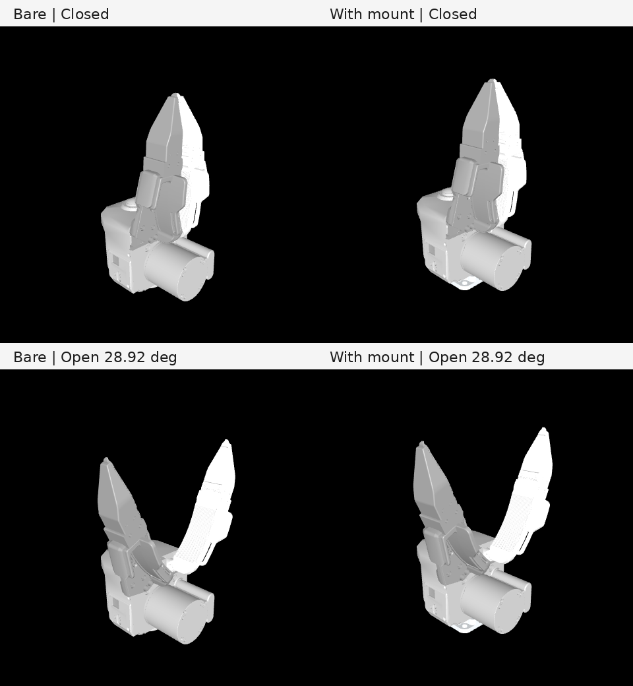

# XTac-UMI-Description

URDF, Xacro, MJCF and USD descriptions of the XTac-UMI (TacCap G1) grippers:
the left/right **master** (handheld leader) and the **slave** (arm-mounted
follower), packaged for ROS 2 and as a framework-independent Python wheel.



| Package | Content |
| --- | --- |
| [`ros/taccap_description`](ros/taccap_description/README.md) | Slave gripper: `taccap_g1_slave.urdf` (bare) and `taccap_g1_slave_with_mount.urdf` (with the Asm_link adapter), prefixable Xacro macro, MJCF, USD, RViz launch |
| [`ros/taccap_master_description`](ros/taccap_master_description/README.md) | Left/right master grippers: URDF, prefixable Xacro, kinematic MJCF preview, USD with an open/close animation, RViz launch |
| `python/taccap_description`, `python/taccap_master_description` | Path API that resolves the installed files (no ROS or simulator needed) |

## Frame contract

Same convention as the Robotiq 2F-85, Franka Hand and xArm Gripper
descriptions: the gripper base link sits on its own mounting face, carries the
body mesh and mass, and **+Z points along the tool axis**; +Y points to the
left finger. All link frames share these axes; meshes keep their native CAD
frame through origins.

| Slave link | Meaning |
| --- | --- |
| `taccap_mount_link` | Root with the adapter: arm-flange contact face of Asm_link |
| `taccap_base_link` | Gripper mounting face (root when bare), body mesh and inertial |
| `taccap_left/right_finger_link` | Fingers; `taccap_right_finger_joint` drives, the left mimics with -1 |
| `taccap_eef_link` | Centre of the closed fingertips' most distal face |
| `taccap_camera_link`, `taccap_camera_optical_link` | Wrist camera (CAD-marked point) and REP-103 optical frame |

Master links use `<side>_` (`left`/`right`): `<side>_base_link` on the shell
rear surface, `<side>_follower_link` matching the slave `taccap_base_link`, and
the same finger/EEF/camera frames. In the follower frame, master and slave EEF,
fingertips, camera and hinge lines agree within 0.1 mm. Details and numbers:
[docs/TACCAP_FLANGE_FRAMES.md](docs/TACCAP_FLANGE_FRAMES.md)
([中文](docs/TACCAP_FLANGE_FRAMES-zh.md)).

## Use

ROS 2 (Humble/Jazzy):

```bash
cd ~/ws/src && git clone https://github.com/XenseRobotics-AI/XTac-UMI-Description.git
cd ~/ws && colcon build && source install/setup.bash
ros2 launch taccap_description display.launch.py with_mount:=true
ros2 launch taccap_master_description display.launch.py side:=left
```

```xml
<xacro:include filename="$(find taccap_description)/urdf/taccap_g1_slave_macro.xacro"/>
<xacro:taccap_g1_slave prefix="right_" with_mount="false"/>
<joint name="arm_to_gripper" type="fixed">
  <parent link="tool0"/><child link="right_taccap_base_link"/>
  <origin xyz="0 0 0" rpy="0 0 0"/>  <!-- clocking about Z per installation -->
</joint>
```

Python:

```bash
pip install git+https://github.com/XenseRobotics-AI/XTac-UMI-Description.git
```

```python
from taccap_description import get_urdf_path, get_mjcf_path, get_usd_path
from taccap_master_description import get_master_urdf_path

get_urdf_path(with_mount=True)
get_master_urdf_path(side="left")
```

Plain `.urdf` files use relative mesh paths and open directly in URDF viewers.

## Development

```bash
pip install -e '.[dev]'
python scripts/generate_models.py          # slave URDF + MJCF from the Xacro
python scripts/generate_usd.py             # slave USD
python scripts/generate_master_models.py   # master Xacro/MJCF/USD from the URDFs
python -m pytest -q
```

Edit `ros/taccap_description/urdf/taccap_g1_slave_macro.xacro` (slave) or
`ros/taccap_master_description/urdf/taccap_g1_master_{left,right}.urdf`
(master); everything else is generated. `--check` verifies generated files.

## License

MIT, see [LICENSE](LICENSE). Source and third-party license notices for the
imported model files: [slave](ros/taccap_description/NOTICE.md),
[master](ros/taccap_master_description/NOTICE.md).
