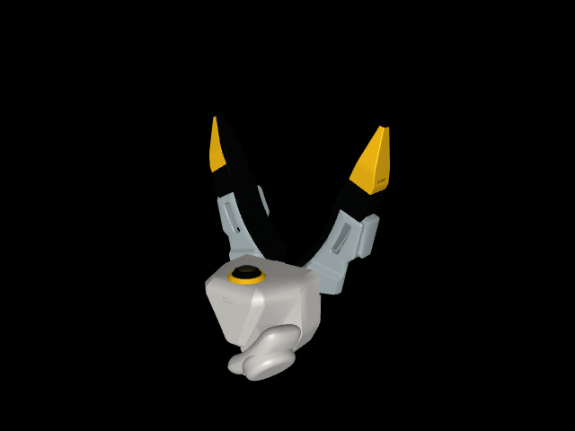

# TacCap G1 主夹爪

[English](README.md)

手持主夹爪，分左右手。仅含视觉与运动学信息，没有质量、惯量和碰撞。
ROS 包 `taccap_master_description`；Python 模块 `taccap_description.master`。



## 入口文件

| 格式 | 文件 | 说明 |
| --- | --- | --- |
| URDF | `urdf/taccap_g1_master_{left,right}.urdf` | 手工编辑，其余格式均由它生成 |
| Xacro | `urdf/taccap_g1_master_{left,right}.urdf.xacro` | 可加前缀的宏 |
| Xacro（显示） | `urdf/display_{left,right}.urdf.xacro` | 供 RViz 使用的独立机器人 |
| MJCF | `mjcf/{left,right}.xml` | mocap 刚体，无关节、无接触 |
| USD | `usd/{left,right}.usda` | 闭合姿态 |
| USD 动画 | `usd/{left,right}_open_close.usda` | 2 秒内闭合 → 张开 → 闭合 |

```python
from taccap_description import master
master.get_urdf_path(side="left")      # 另有 get_xacro_path、get_mjcf_path、get_usd_path(animated=)
```

左右手的所有坐标系、EEF 和关节范围相同，区别在于 PICO 追踪器所在侧和网格。追踪器位姿请用
`<side>_tracker_link`，与从爪对应请用 `<side>_follower_link`。详见
[坐标系规范](../../docs/TACCAP_FLANGE_FRAMES-zh.md)。

`<side>_right_joint` 为主动关节，范围 0 至 0.5047 rad（28.92°），0 为闭合；
`<side>_left_joint` 镜像跟随。

## RViz

```bash
ros2 launch taccap_master_description display.launch.py            # 左手
ros2 launch taccap_master_description display.launch.py side:=right
```

固定坐标系为 `<side>_base_link`；`prefix:=` 为 link、joint 和材质加前缀。

## MuJoCo 预览

```bash
python scripts/view_master.py --side left                  # 动画
python scripts/view_master.py --side right --opening 0.5   # 固定开度
```

```python
import mujoco
from taccap_description import master
from taccap_description.mujoco_preview import set_opening

model = mujoco.MjModel.from_xml_path(str(master.get_mjcf_path(side="left")))
data = mujoco.MjData(model)
set_opening(model, data, 0.5)  # 归一化 [0, 1]，不是弧度
```

模型没有自由度，`mj_step` 不会让手指运动；`set_opening` 设置姿态并调用 `mj_forward`。
EEF 处的 `tcp` 站点位于显示组 3。

## Xacro

```xml
<xacro:include filename="$(find taccap_master_description)/urdf/taccap_g1_master_left.urdf.xacro"/>
<xacro:taccap_master_left/>
```

右手用 `taccap_master_right`。`prefix` 为 link、joint 和材质加前缀；`mesh_root` 默认为
`package://taccap_master_description/meshes`。

## 重新生成

编辑 `urdf/taccap_g1_master_{left,right}.urdf` 后运行 `python scripts/generate_master_models.py`。
来源与声明见 [NOTICE](NOTICE.md)。
