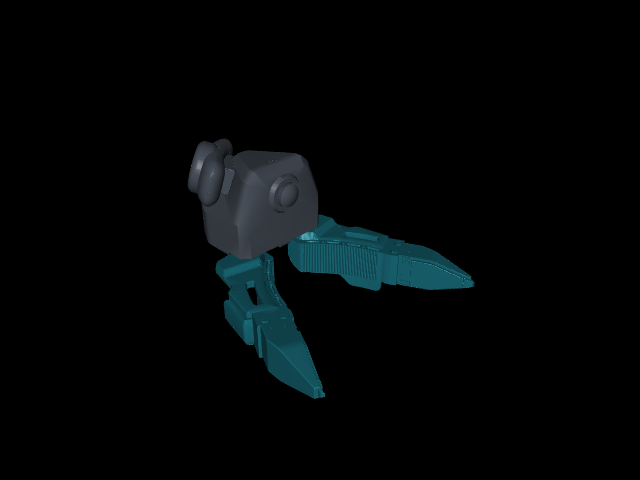

# TacCap G1 master

[中文](README-zh.md)

Handheld master gripper, left and right. Visual and kinematic models (no mass,
inertia or collision data). ROS package: `taccap_master_description`.



## Links and frames

`<side>` is `left` or `right`.

| Link | Origin |
| --- | --- |
| `<side>_base_link` (root) | Centre of the shell rear outer surface, on the tool axis; carries the shell |
| `<side>_right_link` / `<side>_left_link` | Finger hinges (−Y / +Y) |
| `<side>_pico_link` | PICO tracker |
| `<side>_eef_link` | Centre of the closed fingertips' most distal face, `[0.036575, 0, 0.1894217]` m from the root |
| `<side>_camera_link` / `<side>_camera_optical_link` | Wrist camera; optical frame follows REP-103 |
| `<side>_follower_link` | Matches the slave `taccap_base_link`, `[0, 0, -0.0115]` m from the root |

Axes match the slave: +Z along the tool axis toward the fingertips, +Y toward
the left finger. In the `<side>_follower_link` frame, the master and slave EEF,
fingertips, camera and hinge axes agree within 0.1 mm. For teleoperation, the
arm flange is that frame for a bare slave, or that frame shifted by
`[0, 0, -0.012]` m for a slave with the adapter. Details are in the
[frame specification](../../docs/TACCAP_FLANGE_FRAMES.md).

The left and right masters share all frames, the EEF and the joint limits;
they differ in the PICO tracker position (mounted on opposite sides of the
shell) and the side-specific meshes. See
[left and right masters](../../docs/TACCAP_FLANGE_FRAMES.md#left-and-right-masters).

`<side>_right_joint` drives, 0 to 0.5047 rad (28.92°), 0 = closed;
`<side>_left_joint` mimics it with multiplier −1. Tracker-to-TCP transforms
belong to the application.

## Entry points

| Format | Files | Notes |
| --- | --- | --- |
| URDF | `urdf/taccap_g1_master_{left,right}.urdf` | Source of all other formats |
| Xacro | `urdf/taccap_g1_master_{left,right}.urdf.xacro` | Prefixable macros |
| Xacro (display) | `urdf/display_{left,right}.urdf.xacro` | Standalone robots for RViz |
| MuJoCo | `mjcf/{left,right}.xml` | Mocap bodies, one per link; no joints, actuators or contacts |
| USD | `usd/{left,right}.usda` | Closed, visual only |
| USD animation | `usd/{left,right}_open_close.usda` | Closed → open → closed over 2 s (frames 0/60/120 at 60 fps) |

Python, from `taccap_master_description`: `get_master_urdf_path(side=...)`,
`get_master_xacro_path(side=...)`, `get_master_mjcf_path(side=...)`,
`get_master_usd_path(side=..., animated=False)`.

USD rotations are in degrees; prims nest along the URDF tree, e.g.
`/Master/left_base_link/left_right_link`.

## RViz

```bash
ros2 launch taccap_master_description display.launch.py            # left
ros2 launch taccap_master_description display.launch.py side:=right
```

Opens RViz with a joint slider (fixed frame `<side>_base_link`). Pass `prefix:=`
to namespace links, joints and materials.

## MuJoCo preview

```bash
python scripts/view_master.py --side left                  # animated
python scripts/view_master.py --side right --opening 0.5   # fixed opening
python -m mujoco.viewer --mjcf ros/taccap_master_description/mjcf/left.xml
```

```python
import mujoco
from taccap_master_description import get_master_mjcf_path
from taccap_master_description.mujoco_preview import set_opening

model = mujoco.MjModel.from_xml_path(str(get_master_mjcf_path(side="left")))
data = mujoco.MjData(model)
set_opening(model, data, 0.5)  # normalized [0, 1], not radians

site = mujoco.mj_name2id(model, mujoco.mjtObj.mjOBJ_SITE, "tcp")
position = data.site_xpos[site]  # the <side>_eef_link origin
```

The model has no degrees of freedom (`nq = nv = nu = 0`), so `mj_step` does not
move the fingers; `set_opening` poses them and calls `mj_forward`. The `tcp`
site is in display group 3 (press `3` in the viewer); the `open` keyframe is
the fully open pose.

## Xacro

```xml
<xacro:include filename="$(find taccap_master_description)/urdf/taccap_g1_master_left.urdf.xacro"/>
<xacro:taccap_master_left/>
```

Use `taccap_master_right` for the right side. The optional `prefix` namespaces
links, joints, mimic references and materials; `mesh_root` defaults to
`package://taccap_master_description/meshes`. Attach `<side>_base_link` to your
assembly with a fixed joint.

## Regenerate

Edit `urdf/taccap_g1_master_{left,right}.urdf`, then run
`python scripts/generate_master_models.py` (`--urdf-only` updates only the
Xacro, `--check` verifies). See [source and notices](NOTICE.md).
