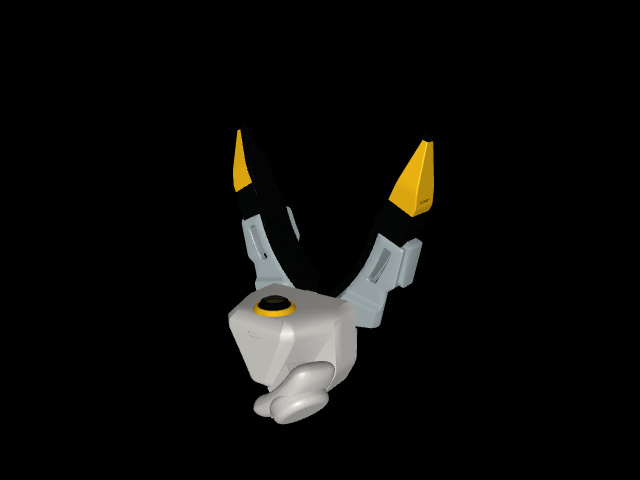

# TacCap G1 master

[中文](README-zh.md)

Handheld master gripper, left and right. Visual and kinematic only: no mass,
inertia or collision.
ROS package `taccap_master_description`; Python module `taccap_description.master`.



## Entry points

| Format | Files | Notes |
| --- | --- | --- |
| URDF | `urdf/taccap_g1_master_{left,right}.urdf` | Hand-edited source of all other formats |
| Xacro | `urdf/taccap_g1_master_{left,right}.urdf.xacro` | Prefixable macros |
| Xacro (display) | `urdf/display_{left,right}.urdf.xacro` | Standalone robots for RViz |
| MJCF | `mjcf/{left,right}.xml` | Mocap bodies, no joints or contacts |
| USD | `usd/{left,right}.usda` | Closed pose |
| USD animation | `usd/{left,right}_open_close.usda` | Closed → open → closed over 2 s |

```python
from taccap_description import master
master.get_urdf_path(side="left")      # also get_xacro_path, get_mjcf_path, get_usd_path(animated=)
```

Both hands share every frame, the EEF and the joint limits; they differ in the
PICO tracker side and the meshes. Use `<side>_tracker_link` for the tracker
pose, and `<side>_follower_link` to match a slave. See the
[frame specification](../../docs/TACCAP_FLANGE_FRAMES.md).

`<side>_right_joint` drives, 0 to 0.5047 rad (28.92°), 0 = closed;
`<side>_left_joint` mirrors it.

## RViz

```bash
ros2 launch taccap_master_description display.launch.py            # left
ros2 launch taccap_master_description display.launch.py side:=right
```

Fixed frame `<side>_base_link`; `prefix:=` namespaces links, joints and materials.

## MuJoCo preview

```bash
python scripts/view_master.py --side left                  # animated
python scripts/view_master.py --side right --opening 0.5   # fixed opening
```

```python
import mujoco
from taccap_description import master
from taccap_description.mujoco_preview import set_opening

model = mujoco.MjModel.from_xml_path(str(master.get_mjcf_path(side="left")))
data = mujoco.MjData(model)
set_opening(model, data, 0.5)  # normalized [0, 1], not radians
```

The model has no degrees of freedom, so `mj_step` does not move the fingers;
`set_opening` poses them and calls `mj_forward`. The `tcp` site at the EEF is in
display group 3.

## Xacro

```xml
<xacro:include filename="$(find taccap_master_description)/urdf/taccap_g1_master_left.urdf.xacro"/>
<xacro:taccap_master_left/>
```

Use `taccap_master_right` for the right hand. `prefix` namespaces links, joints
and materials; `mesh_root` defaults to `package://taccap_master_description/meshes`.

## Regenerate

Edit `urdf/taccap_g1_master_{left,right}.urdf`, then run
`python scripts/generate_master_models.py`. See [source and notices](NOTICE.md).
