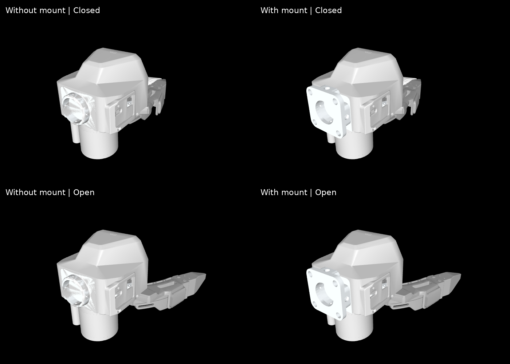

# TacCap G1 从夹爪

[English](README.md)

装在机械臂上的夹爪，提供裸爪与带 Asm_link 法兰转接件两种版本。
ROS 包 `taccap_slave_description`；Python 模块 `taccap_description.slave`。



## 入口文件

| 格式 | 文件 |
| --- | --- |
| URDF | `urdf/taccap_g1_slave.urdf`、`urdf/taccap_g1_slave_with_mount.urdf` |
| Xacro | `urdf/taccap_g1_slave_macro.xacro`（宏）、`urdf/taccap_g1_slave.urdf.xacro`（独立） |
| MJCF | `mjcf/taccap_g1_slave.xml`、`mjcf/taccap_g1_slave_with_mount.xml`、`mjcf/scene.xml` |
| USD | `usd/taccap_g1_slave.usda`、`usd/taccap_g1_slave_with_mount.usda` |

```python
from taccap_description import slave
slave.get_urdf_path(with_mount=True)   # 另有 get_xacro_path、get_mjcf_path、get_usd_path
```

Xacro 宏参数为 `prefix`、`with_mount` 和 `mesh_root`。模型参数见 [config/model.json](config/model.json)，
坐标系与偏移见[坐标系规范](../../docs/TACCAP_FLANGE_FRAMES-zh.md)。

## 关节

`taccap_right_finger_joint` 为主动关节，范围 0 至 0.5047 rad（28.92°），0 为闭合；
`taccap_left_finger_joint` 镜像跟随（URDF `mimic`、MJCF equality、USD PhysX mimic）。
1.1 N·m 限值是 RobStride EL05 手指电机的最大输出扭矩，只在 Xacro 中定义一次，
MJCF 的 `forcerange` 和 USD 的 `maxForce` 都由它生成。

## RViz

```bash
ros2 launch taccap_slave_description display.launch.py                   # 裸爪
ros2 launch taccap_slave_description display.launch.py with_mount:=true  # 带转接件
```

固定坐标系为 `taccap_base_link`；`prefix:=` 为 link、joint 和材质加前缀。

## MuJoCo

沿用 robosuite 命名：执行器 `gripper`（位置控制，0 至 0.5047 rad），`taccap_eef_link` 上的
`grip_site` 和 `ee*` 站点，以及法兰贴合面上带 `force_ee`/`torque_ee` 传感器的 `ft_frame`。
`mjcf/scene.xml` 增加了地面和光源。

## USD / Isaac Sim

```python
from pxr import Usd
from taccap_description import slave
stage = Usd.Stage.Open(str(slave.get_usd_path(with_mount=True)))
```

- 默认 prim 为 `/TacCap`，Z 轴朝上，单位米和千克。**角度单位为度**：把
  `/TacCap/joints/taccap_right_finger_joint` 的 `drive:angular:physics:targetPosition`
  设为 `28.92` 张开，`0` 闭合。
- 只有右关节带驱动，左关节通过 `PhysxMimicJointAPI` 跟随，需要 Isaac Sim 等 PhysX 运行时。
- 不含世界、地面、光照和物理场景。
- `joints/root_fixed_joint` 把夹爪固定在世界上。装到机器人上时，用你的法兰关节替换它，并移除其
  articulation root API。

## 重新生成

编辑 `urdf/taccap_g1_slave_macro.xacro` 后运行 `python scripts/generate_models.py` 和
`python scripts/generate_usd.py`。来源与声明见 [NOTICE](NOTICE.md)。
