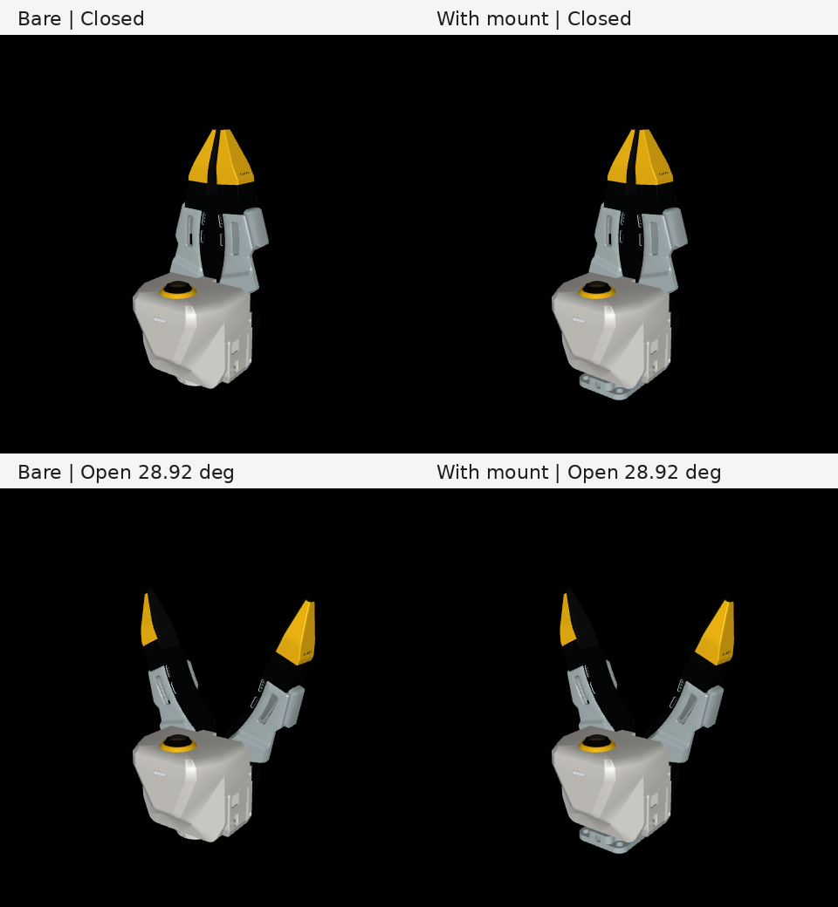

# TacCap G1 slave

[中文](README-zh.md)

Arm-mounted gripper, bare or with the flange adapter. Model `slave-v2026.10.23`:
0.750 kg bare, 0.785 kg with the adapter. Body, motor (299 g) and camera
module (18 g) are separate inertial links (`taccap_motor_link`,
`taccap_camera_body_link`) with upstream centres of mass and full inertia
tensors. ROS package `taccap_slave_description`; Python module
`taccap_description.slave`.



## Entry points

| Format | Files |
| --- | --- |
| URDF | `urdf/taccap_g1_slave.urdf`, `urdf/taccap_g1_slave_with_mount.urdf` |
| Xacro | `urdf/taccap_g1_slave_macro.xacro` (macro), `urdf/taccap_g1_slave.urdf.xacro` (standalone) |
| MJCF | `mjcf/taccap_g1_slave.xml`, `mjcf/taccap_g1_slave_with_mount.xml`, `mjcf/scene.xml` |
| USD | `usd/taccap_g1_slave.usda`, `usd/taccap_g1_slave_with_mount.usda` |

```python
from taccap_description import slave
slave.get_urdf_path(with_mount=True)   # also get_xacro_path, get_mjcf_path, get_usd_path
```

The Xacro macro takes `prefix`, `with_mount` and `mesh_root`. Model parameters
are in [config/model.json](config/model.json); frames and offsets are in the
[frame specification](../../docs/TACCAP_FLANGE_FRAMES.md).

## Joints

`taccap_right_finger_joint` drives, 0 to 0.5047 rad (28.92°), 0 = closed;
`taccap_left_finger_joint` mirrors it (URDF `mimic`, MJCF equality, USD PhysX
mimic). The 1.1 N·m limit is the RobStride EL05 finger motor's maximum output
torque, set once by the importer (`scripts/import_slave.py`); the MJCF
`forcerange` and USD `maxForce` are generated from it.

## RViz

```bash
ros2 launch taccap_slave_description display.launch.py                   # bare
ros2 launch taccap_slave_description display.launch.py with_mount:=true  # with adapter
```

Fixed frame `taccap_base_link`; `prefix:=` namespaces links, joints and materials.

## MuJoCo

Robosuite-style names: actuator `gripper` (position control, 0 to 0.5047 rad),
sites `grip_site` and `ee*` on `taccap_eef_link`, and `ft_frame` with sensors
`force_ee`/`torque_ee` on the flange contact face. `mjcf/scene.xml` adds a floor
and light.

## USD / Isaac Sim

```python
from pxr import Usd
from taccap_description import slave
stage = Usd.Stage.Open(str(slave.get_usd_path(with_mount=True)))
```

- Default prim `/TacCap`, Z-up, metres and kilograms. **Angles are in degrees**:
  set `drive:angular:physics:targetPosition` on
  `/TacCap/joints/taccap_right_finger_joint` to `28.92` to open, `0` to close.
- Only the right joint has a drive; the left follows via `PhysxMimicJointAPI`,
  which needs a PhysX runtime such as Isaac Sim.
- No world, ground, light or physics scene is included.
- `joints/root_fixed_joint` fixes it to the world. To mount it on a robot,
  replace that joint with your flange joint and remove its articulation-root API.

## Regenerate

The model is imported from a locked upstream snapshot: run
`python scripts/import_slave.py` (Xacro and meshes), then
`python scripts/generate_appearance_parts.py`, `python scripts/generate_models.py`
and `python scripts/generate_usd.py`. See [source and notices](NOTICE.md) and the
[update workflow](../../docs/UPSTREAM_SLAVE.md).
